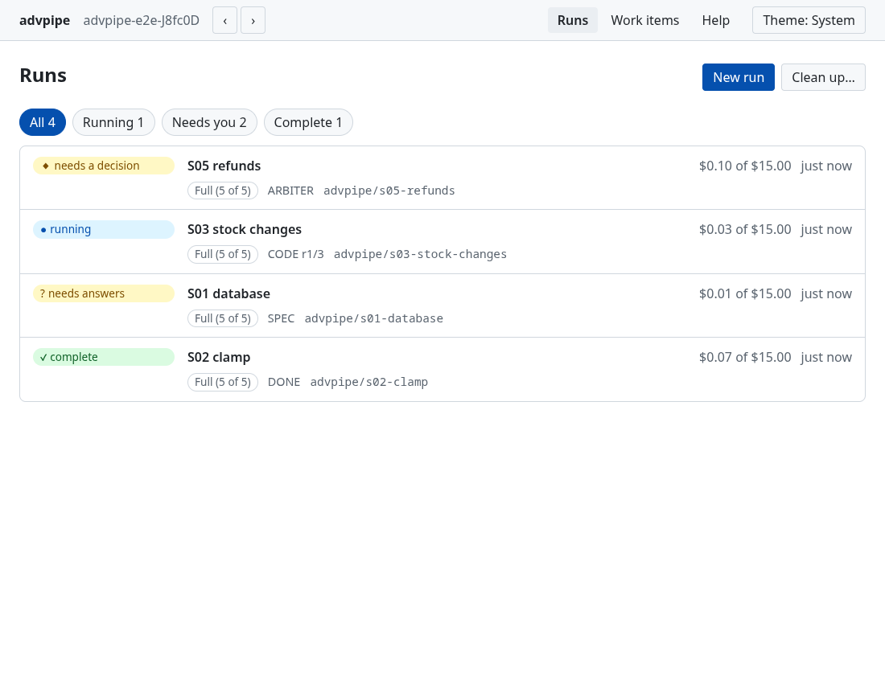
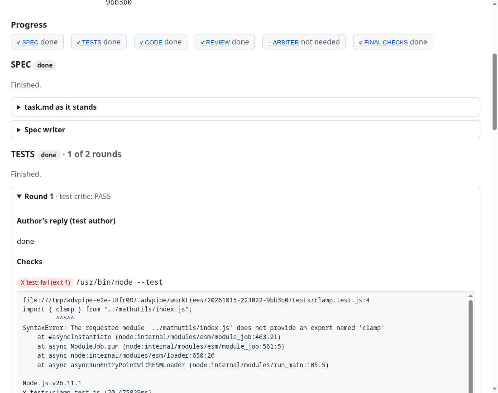

# advpipe

**Hand it a coding task. Get back a git branch with tests, an implementation and a review report,
made by AI agents that check each other's work.** A desktop app for Linux, macOS and Windows: you
click, you don't type commands.



- [What is this?](#what-is-this)
- [Install](#install)
- [First run](#first-run)
- [How much checking: the levels](#how-much-checking-the-levels)
- [Reviewing the result](#reviewing-the-result)
- [What it costs](#what-it-costs)
- [Safety](#safety)
- [Troubleshooting](#troubleshooting)
- [FAQ](#faq)
- [Developing advpipe](#developing-advpipe)

## What is this?

A single AI agent marks its own homework: it writes the code, decides it looks fine, and says it's
done. advpipe splits the job across agents with different roles and makes them **check each other**:

- one agent writes a spec with acceptance criteria;
- one writes tests from the spec _before any code exists_ (and they must fail first), and another
  pokes holes in those tests;
- one writes the code, and another hunts for concrete bugs in it;
- two reviewers look at the finished change, one for quality, one for security;
- an arbiter settles disagreements.

Your own checks (tests, types, lint, a security scan) run after every step, and a failing check is
always a finding. Every loop is bounded by round caps and a dollar budget. **advpipe never pushes,
merges or opens pull requests**: it leaves a branch, and you review and merge it.

## Install

**From an installer.** `npm run dist` builds the installers for the machine it runs on and puts them
in `release/`:

| System  | You get                                                |
| ------- | ------------------------------------------------------ |
| Linux   | `advpipe-<version>-linux-x86_64.AppImage` and a `.deb` |
| macOS   | `advpipe-<version>-mac-<arch>.dmg`                     |
| Windows | `advpipe-<version>-win-x64.exe` (installer)            |

The CI workflow builds all three and keeps them as downloadable artifacts. Installers are large
(about 200 to 250 MB) because they carry the Claude Code binary the agents run on. Nothing else needs
installing, except what is listed next.

**You also need:**

- **git**, with at least one commit in the repo you point advpipe at.
- **A Claude login.** advpipe has no sign-in screen of its own: it uses the login Claude Code keeps on
  your machine, a Claude subscription or an Anthropic Console API key. If you have never used Claude
  Code, sign in once (see [Troubleshooting](#troubleshooting)).
- **Your project's own checks** (its test runner, type checker, linter), because those are what the
  agents' work is judged by.

## First run

A step-by-step version is in [`docs/USAGE.md`](docs/USAGE.md).

1. Open advpipe and choose **Open a repo…** (or start it with a path, `advpipe ~/code/myproject`, where the installer puts `advpipe` on your PATH, as the `.deb` does). The first
   screen checks your setup: git, the repo, and Claude Code.
2. **Work items** → **New work item**: a markdown file describing one task. Or skip it and type a
   one-off task on the **New run** page.
3. **New run**: pick how much checking you want with the slider, look at the money line ("This can
   spend up to $15.00"), and press **Start**.
4. Watch it on the run's page: a timeline, each round's diff, checks and verdicts, and a live log.
   Closing the window doesn't stop a run; reopen the repo to follow it.
5. When it needs you (a blocking question, failing checks it can't fix, a usage limit), the run's
   page says so and shows the buttons for what you can do. You also get a desktop notification.



The checks are commands in a `pipeline.toml` at the repo root (an example is in
`docs/reference/pipeline.example.toml`). Without one, the defaults assume a Python project, so set
`[gates]` to your own commands.

## How much checking: the levels

| Level       | What happens                                                                  | Good for                                     |
| ----------- | ----------------------------------------------------------------------------- | -------------------------------------------- |
| Basic       | One agent does everything; the checks decide                                  | typos, renames, a one-line fix               |
| Reviewer    | One agent works, a second reviews once                                        | small bug fixes you'll skim                  |
| Tests       | Spec, tests written first and shown to fail, code, one review                 | a contained change with clear behaviour      |
| Adversarial | Tests and code each checked by a critic; the arbiter settles disputes         | a feature with real logic                    |
| **Full**    | Everything: critics, standards and security reviewers, arbiter, security scan | risky, security-relevant or user-facing work |

Full is the default. The Help page has the full tables (who sees what, which tools each agent gets).

## Reviewing the result

A finished run's page ends with **Next steps**: git commands with Copy buttons (read the change, merge
it, delete the branch). advpipe shows them and never runs them. The work is on a branch named
`advpipe/<something>`, one commit per stage, made in a separate working copy under
`.advpipe/worktrees/`, so your own working tree is never touched.

Everything a run did is kept under `<repo>/.advpipe/runs/<run id>/`: each agent's reply, the exact
diff each critic judged, every check result, the event log and `report.md`. It's safe to delete, and
**Clean up** does it for you.

## What it costs

Every agent call is billed to your Claude login. A Full run makes at least 7 calls and at most 30
before it asks you; Basic makes 1. The New run page shows the numbers for the level you picked. A
small, well-defined change at Full typically costs well under a dollar or two; vague or tangled tasks
cost several times that. The budget (default **$15** a task) is a hard stop: the run ends _over
budget_ and you can **Resume** it with a bigger one.

With a Claude **subscription**, the dollar figures are API-equivalent estimates, not charges, and the
app shows how much of your usage windows are used. With **Console credits** it is real money, and the
app warns you before every start. If you hit a usage limit the run **pauses** (nothing is lost) and
asks whether to try again or finish as it is.

## Safety

- **Agents run shell commands without asking.** The test author, coder and solo agent can run any
  command, with your user's permissions, inside the run's working copy. There is no sandbox. Use
  advpipe on code you trust, on a machine where that's acceptable.
- **Your working tree is never modified.** All work is in a separate git worktree on its own branch.
- **Nothing is pushed, merged or opened as a pull request**, ever.
- **Your code is sent to the Claude API**, as with any AI coding tool.
- **The app itself makes no network requests**, has no telemetry and uploads no crash reports. Only
  the bundled Claude Code talks to Anthropic. The window has no access to your files or a shell: it
  talks to the app through a small, validated set of messages.
- **Review before merging.** advpipe makes your review faster; it doesn't replace it.

## Troubleshooting

**"Claude Code wasn't found in this install."** The installer is incomplete or damaged: reinstall.

**Every run says "Not logged in".** Sign in to Claude Code once, then try again. Install Claude Code
from Anthropic and run `claude` in a terminal, choose _Log in_, and finish in the browser; or set an
`ANTHROPIC_API_KEY` for the app's environment.

**"This folder isn't a git repo" / "needs a first commit".** Run `git init` and make one commit.
Open the folder that contains `.git`, not a subfolder.

**A check fails with "command not found" (exit 127).** The command in `[gates]` isn't on the app's
`PATH`. On macOS and Windows, apps started from the dock or start menu may not see your shell's
`PATH`: use an absolute path in `pipeline.toml`.

**Every run stops at the tests step with "Tests don't exercise the change".** Your test command passed
before anything was written. Make sure it actually runs the new test files.

**A run says it stopped.** It was interrupted (closed machine, cancelled, crashed). **Resume**
continues from the first unfinished step.

**Something else.** Help → _Open log folder_ has the app's log; a run's own output is in
`.advpipe/runs/<run id>/console.log`.

## FAQ

**Which languages?** Any, as long as your checks are shell commands.

**Can I change how an agent behaves?** The role instructions are `assets/prompts/<role>.md`, copied
into the app at build time; keep `.claude/agents/<role>.md` in sync (`npm run check:prompts` checks it).

**Does it work offline?** No. The agents run on the Claude API.

**Does it run on Windows/macOS?** Yes. The Linux build is the one tested by hand so far; see the
milestone notes in `docs/11-MILESTONES.md`.

## Developing advpipe

The project is an npm-workspaces monorepo (Electron, TypeScript, React). **Start at
[`docs/README.md`](docs/README.md)** and `CLAUDE.md`.

```sh
npm install
npm run dev              # the app, with devtools
npm run typecheck && npm run lint && npm test
npm run test:e2e         # Playwright against the fake-agent build (needs a display; xvfb-run on CI)
npm run pack             # package for this OS into release/ (unpacked), no installer
npm run dist             # build the installers for this OS into release/
npm run test:packaged    # smoke tests of the packaged app (no API calls, no credentials)
npm run screenshots      # docs/screenshots/*.png
```

Automated tests never call the Claude API: agents are scripted fakes. A real call needs the owner's
explicit go-ahead each time.
